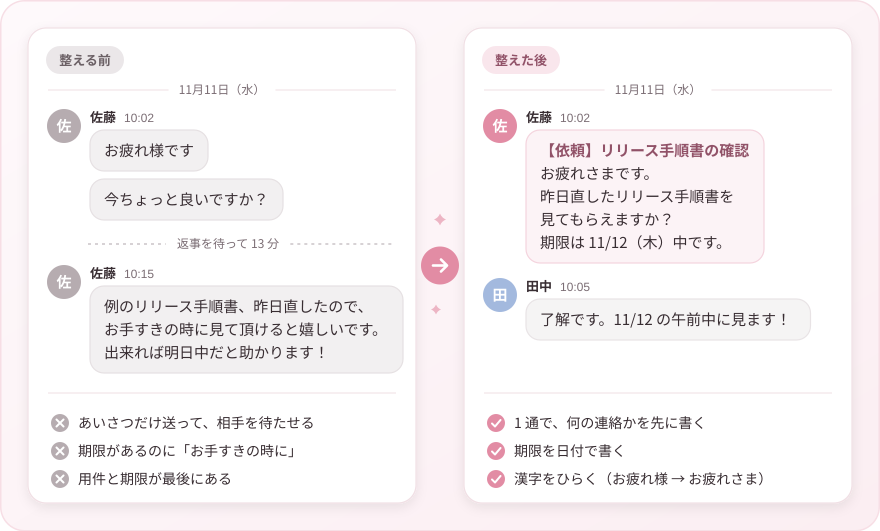

<h1 align="center">
  <picture>
    <source media="(prefers-color-scheme: dark)" srcset="assets/banner-dark.svg">
    
  </picture>
</h1>

<p align="center">
  <a href="https://github.com/tsunyan/friendly-chat/releases/latest"></a>
  <a href="LICENSE"></a>
  <a href="https://agentskills.io/"></a>
  <a href="#インストール"></a>
</p>

職場のチャットで人に送る日本語のメッセージを、読み手の負荷が小さくなる形に整える、AI エージェント向けのスキルです。[Agent Skills](https://agentskills.io/) の形式（`SKILL.md`）で書いているので、Claude Code、Codex など、この形式に対応したエージェントで使えます。

## 整える前と後

<picture>
  <source media="(prefers-color-scheme: dark)" srcset="assets/before-after-dark.svg">
  
</picture>

整える前は、あいさつだけを送って相手を待たせ、用件と期限を最後に書いています。期限があるのに「お手すきの時に」と書いているので、急ぎかどうかも伝わりません。整えた後は、1 通で何の連絡かを先に書き、期限を日付で書いているので、相手はすぐに返事ができます。

## 対象

Slack、Microsoft Teams、Google Chat、Chatwork、LINE WORKS、Discord などの職場のチャットで、人が人に送るメッセージが対象です。依頼、質問、相談、報告、連絡、催促、返信を書くとき、下書きするとき、見直すときに使います。

メール、文書、PR の説明文、コミットメッセージ、エージェントから利用者への返答には使いません。

## 何をするか

読み手の負荷を 7 種類に分け、ふだんは次の順に整えます。場面によっては順序を変えます。どのコツも必須項目ではなく、読み手の負荷が減る場面にだけ使います。

1. **判断する負荷を減らす（用件を先に出す）**
   - 用件と、してほしいことを冒頭に書く
   - どこまでやれば終わりかを書く
   - 何の連絡か、返信が要るか、急ぎかを示す
   - あいさつや「今いいですか？」だけを送らない
   - 宛先ごとにしてほしいことを書き、メンションは読む必要がある人だけに付ける
2. **返信する負荷を減らす（答えやすくする）**
   - 「はい/いいえ」で答えられる質問には、先に「はい」「いいえ」と答える。条件付きなら条件を先に書く
   - 質問は「はい/いいえ」か選択肢で答えられる形にし、どれでもない答えの余地も残す
   - 自分の案を添える。意見がなければ案で進めるのは、書き手の裁量で進めてよいときだけにする
   - 複数の質問には番号を付け、優先順位も書く
   - 調べたことと試したことを書いてから聞く
   - 否定の形の質問と、二重否定を避ける
   - リアクションで返せる形にする。返信が要らない共有では、リアクションも求めない
   - 往復が長くなりそうなら、相手の都合を聞いて通話を提案する
3. **理解する負荷を減らす（前後の流れを知らなくても通じるようにする）**
   - 指す先を取り違えるおそれがあるときは、「これ」「それ」「例の件」を使わず、指すものの名前を書く
   - 担当が複数いる文や転送されそうな文では、「自分」「こちら」ではなく人の名前で書く
   - 読み手の知っている言葉で書く
   - URL、エラーメッセージ、投稿のリンクを添え、リンクには要点を添えて、相手が開ける状態にする
   - 見直しを頼むときは、前回からの変更点を先に書く
   - 期限と時刻を日付と時刻で書き、返事の期限と作業の期限を分ける
4. **読む負荷を減らす（読みやすくする）**
   - 意味のまとまりごとに空行を入れ、長文は文書にしてリンクを送る
   - 並ぶものは箇条書きにし、長い文は区切る
   - 漢字をひらく（良い → よい、出来る → できる、下さい → ください など、100 語を超える一覧つき）
   - 助詞を省かず、要らない修飾語を削る
   - 「〜したいと思います」は、決めたことなら「〜します」にし、了承が要る提案なら了承を求める形にする
   - 観測したこと、推測、未確認を分けて書く
5. **気持ちの負担を減らす**
   - 責める言葉を書かない。間違いの指摘は、ほかの人が知る必要がなければ DM で伝える
   - 「知ってました」とだけ返さず、「前も言いましたが」を書かない
   - 依頼は言い方をやわらげ、断る、延ばす場合の進め方を書く。催促は状況を確かめる形にする
   - 丁寧にしすぎない
   - 「！」、絵文字、話し言葉を、場に合わせて使う
6. **後で探す負荷を減らす**
   - 1 つの話題に 1 つのスレッドを使う
   - 決まったことは最後にまとめる
7. **待つ負荷と、覚えておく負荷を減らす**
   - すぐに答えられないときは、次に連絡する時点を伝える
   - 終わった用件は閉じる（完了、解決、依頼の取り下げを知らせる）

## インストール

[skills CLI](https://github.com/vercel-labs/skills) を使う場合:

```bash
npx skills add tsunyan/friendly-chat
```

手で置く場合は、`skills/friendly-chat` フォルダを、使うエージェントのスキル用フォルダにコピーします。

| エージェント | 置き場所（ユーザー全体） | 置き場所（プロジェクトごと） |
|---|---|---|
| Claude Code | `~/.claude/skills/friendly-chat/` | `.claude/skills/friendly-chat/` |
| Codex | `~/.agents/skills/friendly-chat/` | `.agents/skills/friendly-chat/` |

ほかのエージェントでは、それぞれのドキュメントにあるスキルの置き場所に置いてください。

### Codex のアプリで使う

[最新のリリース](https://github.com/tsunyan/friendly-chat/releases/latest)から `friendly-chat-v1.0.0.skill` のような `.skill` ファイルをダウンロードし、ダブルクリックして開くと取り込めます。

### claude.ai で使う

claude.ai では、スキルをプラグインとして取り込みます。プラグインは有料のプラン（Pro、Max、Ultra、Team、Enterprise）で使えます。

1. [最新のリリース](https://github.com/tsunyan/friendly-chat/releases/latest)から `friendly-chat-v1.0.0-claude-plugin.zip` のような、名前が `-claude-plugin.zip` で終わるファイルをダウンロードします。`.skill` ファイルは、claude.ai のプラグインの画面では取り込めません。
2. 個人のプランでは、Settings > Capabilities で「Code execution and file creation」（新しい設定画面では「Create and edit files」）を有効にします。
3. サイドバーの「プラグイン」（切り替え前の画面では Customize > Plugins）で、ダウンロードした ZIP をプラグインのファイルとしてアップロードします。

取り込むと、「Friendly chat」という名前のプラグインとして追加されます。中身はこのスキル 1 つだけです。画面の名前は変わることがあります。詳しくは [Use plugins in Claude](https://support.claude.com/en/articles/13837440-use-plugins-in-claude) を見てください。

## 常に使わせたいとき

スキルは、エージェントが「使う場面だ」と判断したときに読み込まれます。チャットの文面を書くたびに必ず使わせたいときは、`CLAUDE.md` や `AGENTS.md` に次のような 1 行を足します。

```markdown
職場のチャットで人に送るメッセージを書くとき、直すときは、friendly-chat スキルに従う。
```

## 元にした情報

- penpen「[フルリモートで相手に気持ちよく仕事をしてもらうためのコツあれこれ](https://zenn.dev/praha/articles/897f354bb76b98)」（PrAha, Zenn, 2024）と、そのコメント欄で寄せられたコツ
- 上の記事で紹介されているニカイドウレンジさんの投稿（[「これ」「それ」を使わない](https://x.com/R_Nikaido/status/1803356532316447203)、[名前で書く](https://x.com/R_Nikaido/status/1803399290129457543)）

記事のコツを、職場のチャットでの読み手の負荷という観点で並べ直し、例文は新しく作っています。記事にない手法として、次のものを足しました。

- あいさつや「今いいですか？」だけを送らない
- どこまでやれば終わりかを書く
- 何の連絡か、返信が要るか、急ぎかを冒頭で示す
- 宛先ごとにしてほしいことを書き、メンションを絞る
- 自分の案と、決まらなかったときの進め方を添える
- 複数の質問に優先順位を書く
- 調べたことと試したことを書いてから聞く
- 否定の形の質問と、二重否定を避ける
- リアクションで返せる形にする
- 読み手の知っている言葉で書く
- リンクやファイルには要点を添え、相手が開ける状態にする
- 見直しを頼むときは、前回からの変更点を先に書く
- 返事の期限と作業の期限を分ける
- チャットの見た目を整える（意味のまとまりごとの空行、長文は文書に、太字はいちばん大事な箇所だけ）
- 観測したこと、推測、未確認を分けて書く
- 依頼は言い方をやわらげ、断る、延ばす場合の進め方を書く
- 1 つの話題に 1 つのスレッドを使い、決まったことは最後にまとめる
- すぐに答えられないときは、次に連絡する時点を伝える
- 終わった用件は閉じる

## ライセンス

[MIT](LICENSE)
